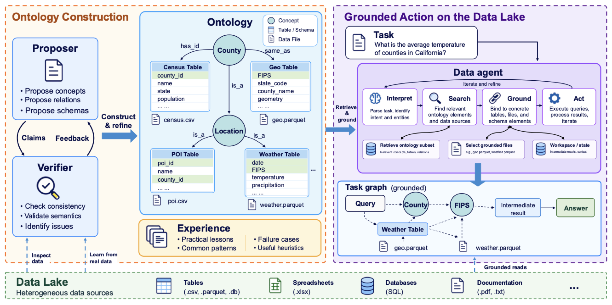

# OGDA: Ontology-Grounded Data Agents for Reliable Analysis over Heterogeneous Data Lakes



Research code for **OGDA**, which constructs an ontology for a data lake and uses it to ground data analysis. Construction operates on the lake and its documentation without seeing downstream questions. A data agent then searches the finished ontology, grounds the files it needs, and computes an answer with a recorded task graph.

## Overview

1. **Construct the ontology.** Map files to schemas and tables, check supported structures, and independently verify inferred schemas. Enrich accepted definitions with concepts and links.
2. **Ground the analysis.** Retrieve ontology objects and add them to a task graph before opening their files. The data agent reads the lake copy and writes derived files into its own workspace.
3. **Inspect the evidence.** Save claims, experience, model traces, grounded objects, file reads, derived artifacts, and answers.

Concepts, links, and experience are guidance rather than independently verified facts.

## Installation

OGDA runs on **Linux with Landlock ABI 3 or later and `libseccomp.so.2`**. The isolated code worker requires these operating-system facilities.

Install [uv](https://docs.astral.sh/uv/getting-started/installation/), then create the environment from the repository root:

```bash
uv sync --locked --extra benchmarks   # creates .venv from uv.lock, with Python 3.11 or later
uv run ogda --help
```

`uv sync` installs a suitable Python if none is present, and `uv.lock` pins every dependency. Run every command through `uv run`, which uses the project's `.venv`. Drop `--extra benchmarks` if you will not run the benchmarks.

## Quick start

Copy the configuration template:

```bash
cp config.example.yaml config.yaml
```

Set `llm.model` and `llm.base_url` for your provider, and set the `PROVIDER_API_KEY` environment variable named by `llm.api_key_env`. Configure any provider-specific reasoning options explicitly. The template contains placeholders and no credentials; its budgets are example settings, not a specification of the paper's experiments.

Point OGDA at any folder of data files (your lake) and write the task as JSON, for example `{"id": "q1", "question": "What is the total sales amount by region?"}`. Keep the task file outside the lake so construction cannot see the question.

```bash
# Build an ontology without exposing the task to construction.
uv run ogda build \
  --config config.yaml --lake path/to/lake \
  --output results/mylake/ogda \
  --scratch exp_env/mylake/ogda

# Search the saved ontology without making model calls.
uv run ogda search \
  --ontology results/mylake/ogda/ontology 'sales amount by region'

# Answer the task using the finished ontology.
uv run ogda ask \
  --config config.yaml --ontology results/mylake/ogda/ontology \
  --task task.json \
  --output results/mylake/ogda/tasks/q1 \
  --scratch exp_env/mylake/ogda/tasks/q1
```

`build` and `ask` make calls to your configured model. The answer and task graph are saved in `results/mylake/ogda/tasks/q1/result.json`.

## Benchmarks

Benchmark sources and datasets are not bundled in this copy. Obtain the upstream checkouts described in [`benchmark/README.md`](benchmark/README.md), then install the evaluator dependencies and prepare separate data lakes:

```bash
uv sync --locked --extra benchmarks
uv run python scripts/prepare_datalakes.py --benchmark all
```

Copy and fill in the generation and evaluator templates under [`llm_config/`](llm_config/README.md). Then validate the configuration and inputs without making model calls:

```bash
uv run bash scripts/run/kramabench_ogda.sh --dry-run
uv run bash scripts/run/discoverybench_ogda.sh --dry-run
```

The same launchers support `--stage construction`, `--stage tasks`, `--stage evaluation`, and `--stage pipeline` (the default). KramaBench runs all 104 main tasks; DiscoveryBench runs the 239 real test questions. See [`scripts/README.md`](scripts/README.md) for complete commands, configuration, separate stages, and resume. Construction sees only copied data and sanitized documentation; evaluation uses the native upstream scorers.

## Repository guide

| Path | Contents |
| --- | --- |
| [`ogda-ossie-adapted/`](ogda-ossie-adapted/README.md) | The Ossie-based implementation with the task graph, its benchmark scripts and tests |
| [`ogda/`](ogda/) | Ontology models, construction, retrieval, data agent, prompts, model profiles, and isolated execution |
| [`ogda/adaptor/`](ogda/adaptor/) | Benchmark preparation, construction, task execution, and native evaluation |
| [`benchmark/`](benchmark/README.md) | Setup instructions for external KramaBench and DiscoveryBench checkouts |
| [`scripts/`](scripts/README.md) | Data preparation and benchmark launchers |
| [`llm_config/`](llm_config/README.md) | Generation and evaluator configuration templates |
| [`config.example.yaml`](config.example.yaml) | Model and agent configuration template |
| [`docs/usage.md`](docs/usage.md) | Configuration, custom lakes, resume, task inputs, and output files |

The core commands use this project directly. Benchmark launchers additionally require the external checkouts and datasets described above.
