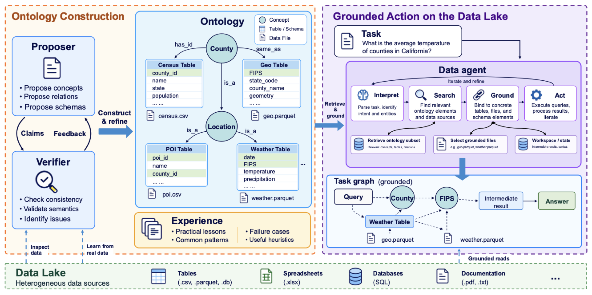

# OGDA: Ontology-Grounded Data Agents for Reliable Analysis over Heterogeneous Data Lakes



## Abstract

OGDA builds an ontology over a data lake and uses it to guide data analysis. A proposer infers datasets, concepts, and relationships; a verifier checks proposals against the source data. The data agent searches and grounds data through the ontology, and records its computations in a task graph. Across KramaBench and DiscoveryBench with three LLM backbones, OGDA outperforms the strongest baselines by up to 10.82 points.

## Overview

OGDA works in two stages, one per half of the figure.

1. **Ontology construction** (task-blind). A Proposer agent reads a copy of the Lake and proposes Claims: Concepts (Entity types and Value types), Relationships, and Datasets with their Fields and Bindings. Code checks each answer against the Ontology rules and the data (unique Identifiers, `ManyToOne` and `OneToOne` links), and an independent Verifier judges the meaning of each inferred Dataset. A concept layer then reviews every Concept against the whole Ontology, merging duplicates and turning Attributes into References. An Experience writer records lessons the Ontology cannot express. The Ontology is stored as [Apache Ossie](https://github.com/apache/ossie) documents.
2. **Grounded action** (per Task). The Data agent, one CodeAgent, sees a map of the Lake built from the Ontology and gets data only through two tools. `search(words)` finds Fields by meaning, and `ground(*names)` prints what a Dataset, Field or File means and returns its data, read the way the Ontology describes it. Code reads the agent's steps and records them as the Task graph: which grounded data each variable came from and which variables the answer reads.

## Repository structure

This folder contains the implementation, scripts, and tests. Benchmark sources and datasets must be obtained separately under `../benchmark/`; see [benchmark setup](../benchmark/README.md).

```
ogda-ossie-adapted/
├── assets/                     figures for this README
├── config/
│   └── config.example.yaml     model and run settings; copy to config/config.yaml
├── ogda/                       the OGDA library
│   ├── ossie.py                Ossie document models, schema validation and the Ontology rules
│   ├── ossie_schemas/          vendored Apache Ossie JSON schemas
│   ├── binding.py              Bindings, the structure and data checks, the mapping compiler
│   ├── ontology.py             the Harness (Ontology, Bindings, Claims, Experience) and its store
│   ├── claims.py               Claim parsing, application and answer checks
│   ├── construction.py         the construction loop: iterations, resume and stopping
│   ├── induction.py            schema induction: Proposer visits, verification and layout fan-out
│   ├── concept_layer.py        the concept-layer review of every Concept
│   ├── experience.py           Experience distillation and consolidation
│   ├── data_agent.py           the Data agent: one CodeAgent per Task, and result.json
│   ├── grounding.py            the Lake map and what ground prints and returns
│   ├── dataset_reader.py       a Dataset's rows as a typed DataFrame, cached as Parquet
│   ├── lineage.py              the Task graph read from the agent's code
│   ├── ontology_search.py      BM25 over Fields for the Data agent's search
│   ├── retrieval.py            lexical search over Concepts, Relationships, Datasets and Fields
│   ├── agent.py                one smolagents CodeAgent visit and its token budget
│   ├── models/                 per-model CodeAgent profiles (GPT, DeepSeek)
│   ├── sandbox/                the isolated code worker (Landlock and seccomp, or srt on macOS)
│   ├── lake.py                 Lake copy, File batches and layout groups
│   ├── llm.py                  LiteLLM client and the offline ScriptedClient
│   ├── prompts.py              instructions for every agent role
│   └── cli.py                  the build, search and ask commands
├── scripts/                    the experiment controller
│   ├── prepare_lakes.py        builds clean Lakes (answer Files removed) from each benchmark
│   ├── benchmark.py            the construct, infer and evaluate stages
│   ├── methods.py              the ogda and baseline inference methods
│   ├── benchmarks/             one module per benchmark: Lakes, Tasks, answer check and scoring
│   └── scorers/                wrappers that run each benchmark's official scorer
├── tests/                      offline tests; tests/scripts/ covers the controller
└── pyproject.toml, uv.lock     dependencies, managed with uv
```

## Setup

OGDA uses [uv](https://docs.astral.sh/uv/) and declares Python 3.11 or later in `pyproject.toml`.

For benchmark runs, complete [benchmark setup](../benchmark/README.md) first. From the enclosing project root:

```bash
cd ogda-ossie-adapted
uv sync                          # creates .venv with all dependencies, the dev group and the eval group
cp config/config.example.yaml config/config.yaml   # then fill in model, base_url and api_key
uv run pytest tests              # default tests use offline clients
```

`tests/test_scenarios.py` is a legacy live-model harness for the former planner/analyst API. It is skipped by default and has not been migrated to this implementation.

Agent code runs in an isolated worker. It needs Linux with Landlock (ABI 3 or later) and libseccomp, or macOS with [sandbox-runtime](https://github.com/anthropics/sandbox-runtime) (`npm install -g @anthropic-ai/sandbox-runtime` and `brew install ripgrep`). macOS does not cap worker memory, so run the experiments on Linux.

### Configuration

`config/config.yaml` sets the model and the run limits. The `llm` block takes `model`, `base_url`, and `api_key` or `api_key_env`. Any of these can be overridden per role under `llm.roles`: `proposer`, `verifier`, `experience`, `data_agent` and `evaluator` (the judge).

```yaml
llm:
  model: openai/your-model-id
  base_url: https://your-endpoint/v1
  api_key_env: PROVIDER_API_KEY
  roles:
    evaluator: {model: openai/your-judge-model}
construction:
  max_tokens: 2000000      # token cap for all construction calls of one Lake
  files_per_visit: 8       # Files per Proposer visit
  concepts_per_visit: 30   # Concepts per concept-layer visit
  max_passes: 20           # concept-layer visits
  check_rows: 100000       # rows read per Dataset by the data checks
  agent: {max_steps: 20, cell_timeout_seconds: 30, memory_mb: 4096, max_output_chars: 20000}
data_agent:
  max_tokens: null         # optional token cap per Task
  agent: {max_steps: 20}
```

Each backbone gets its CodeAgent prompt, code-block delimiters and `tool_choice` from a YAML profile in [`ogda/models/`](ogda/models/). To add a backbone, add a profile with its `model_names` and `code_agent` settings.

## Running the experiments

Every experiment runs through `scripts/benchmark.py` in three stages: **construct** builds one Ontology per Lake, **infer** answers every Task, and **evaluate** scores the answers with the benchmark's official scorer. `--benchmark` is `Kramabench` or `discoverybench`. Run all commands from `ogda-ossie-adapted/`.

### 1. Prepare clean Lakes

```bash
uv run python scripts/prepare_lakes.py --benchmark Kramabench
uv run python scripts/prepare_lakes.py --benchmark discoverybench
```

This writes each Lake to `lake/<benchmark>/<lake_id>/` without the benchmark's answer Files, so construction never sees an answer.

### 2. Construct the Ontologies

```bash
uv run python scripts/benchmark.py --benchmark Kramabench --stage construct \
  --config config/config.yaml --run-id ontology_kb --workers 8
```

### 3. Answer the Tasks

OGDA uses the Ontologies from a construct run:

```bash
uv run python scripts/benchmark.py --benchmark Kramabench --stage infer --method ogda \
  --ontology-run ontology_kb --config config/config.yaml --run-id ogda_kb --workers 8
```

The baseline is a plain CodeAgent that reads the Lake directly, with no Ontology:

```bash
uv run python scripts/benchmark.py --benchmark Kramabench --stage infer --method baseline \
  --config config/config.yaml --run-id baseline_kb --workers 8
```

### 4. Score the answers

```bash
uv run python scripts/benchmark.py --benchmark Kramabench --stage evaluate --run-id ogda_kb --config config/config.yaml
```

Repeat steps 2 to 4 with `--benchmark discoverybench`, and with each backbone, by changing `llm.model` in the config or by passing another config file.

### Options

- `--run-id` names the run. It defaults to `ontology_<model>_<UTC>` for construct and `<method>_<model>_<UTC>` for infer, and is required for evaluate, where it names the infer run to score.
- `--lakes`, `--tasks` and `--limit` select a subset; `--resume` continues an interrupted run.
- `--workers` (default 4) sets how many Lakes, Tasks or scorer calls run at once, each in its own process.
- Before any work starts, a preflight check covers the config, the benchmark source directories, the clean Lakes, the sandbox and, for evaluate, the judge.

### The judge

Both official scorers use an LLM judge. Set `llm.roles.evaluator` to the judge model. Its name must start with `openai/`, and its endpoint must support OpenAI chat completions with JSON mode, since both scorers call the OpenAI SDK. Evaluate checks the judge with one call before scoring, because upstream KramaBench records a failed judge call as a score of 0. `evaluate --resume` re-scores only the rows that failed.

### Outputs

```
lake/<benchmark>/                         clean Lakes from prepare_lakes.py
env/<benchmark>/<run-id>/                 sandbox scratch, safe to delete
results/<benchmark>/
  construction/<run-id>/
    run.json                              config (no API key), git commit when available, selected Lakes
    <lake>/ontology/                      ontology.yaml, semantic_model.yaml, mapping.yaml, state.json
    <lake>/logs/  summary.json            agent transcripts, model calls, Claim outcomes
  inference/<run-id>/
    run.json                              method, model, Ontology run, selected Tasks
    tasks/<task-id>/result.json           answer, Task graph, steps, usage and wall time
    tasks/<task-id>/logs/                 agent traces
    predictions.jsonl
    evaluation/<judge-model>_<UTC>/       written by evaluate
      run.json  scores.jsonl  summary.json  logs/
```

## Using OGDA on your own Lake

The `ogda` command builds an Ontology for any folder of Files, searches it, and answers one Task:

```bash
uv run python -m ogda build --config config/config.yaml --lake path/to/lake \
  --output results/mylake/run1 --scratch env/mylake/run1
uv run python -m ogda search --ontology results/mylake/run1/ontology 'household income'

echo '{"id": "q1", "question": "Which county has the highest median household income?"}' > task.json
uv run python -m ogda ask --config config/config.yaml --ontology results/mylake/run1/ontology --task task.json \
  --output results/mylake/run1/tasks/q1 --scratch env/mylake/run1/tasks/q1
```

`build` copies the Lake and never changes the original. `--exclude <glob>` leaves Files out of the copy, and `--strip-key <key>` removes a key from JSON and YAML Files. `build --resume` continues an interrupted run.
